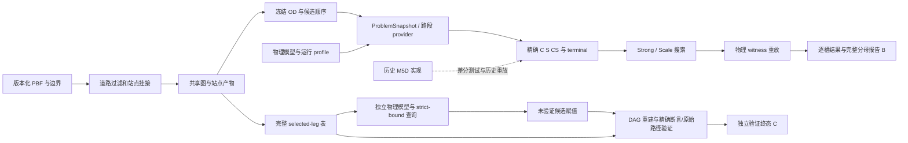

# HiRoute 流水线整合 Phase A 审计报告

审计日期：2026-11-10（Asia/Shanghai）。仓库：`/home/dy/HiRoute/project`。

审计前版本为 `335586bf8c0dc1b14fabe9a629f7455cf6831cff`。按要求先创建了快照提交 `679239d`（`chore: snapshot repository before pipeline consolidation audit`）。提交前工作区干净，因此该提交为空提交，代码树与父版本相同。它保护的是 Git 跟踪内容，不包括被忽略的本地数据、结果和外部实验目录。

**初次审计结论：证据不能唯一确定用户所指的最终方案。** 仓库同时承载当前软件核心、N64 真实 DEV 对比、独立模型可行解改进和历史 M5D 证据。它们有不同的问题域、入口和接受条件。以下保留初次审计的逐候选分析。

**2026-11-10 用户确认并授权实施：** B（N64 Strong/Scale）为研究主线，A 为软件核心，C 保留独立验证扩展；历史实现退出默认流程，保留必要差分对照及可恢复版本。复现接受经校验的历史处理产物起点，原始 PBF 缺口明确记录。允许进入 Phase B；产物未恢复的相关科学验收和删除继续暂停，真实全矩阵/全省重建/holdout 不自动运行。

本阶段只新增这份报告；没有修改现有实现、配置、测试或历史记录，没有删除文件、安装依赖、下载地图、重建大规模数据或运行真实规模求解。

## 1. 审计范围与证据等级

核对了根 README、打包配置、当前状态及关键阶段报告、Git 主线演化、Python 导入关系、函数内延迟导入、脚本子进程调用、原生 C++ 加载、测试组织、已提交结果摘要和本机产物位置。静态图纳入了包 `__init__.py` 的执行依赖；对实际入口另行核对配置分支和子进程边。没有把“无 import 引用”等同于可删除。

审计时有 1,321 个 Git 跟踪文件。主要分布为 `src/` 125、`tools/` 70、`scripts/` 107、`experiments/` 226、`validation/` 101、`tests/` 312、`docs/` 247。它们是本次盘点数字，不是未来源码数量门禁。

证据分为三层：

- **当前可核查**：源码、配置、小型 fixture、已提交摘要，以及本轮通过的轻量测试。
- **历史报告支持**：M5D 大规模运行及近期独立候选验证的结果、时间与收据摘要；本轮没有重新执行这些实验。
- **待恢复核验**：摘要引用的完整图、站点、候选赋值、DAG 审计、原始日志和终态收据。当前工作区不能据此完成端到端复现。

这是连续变量、精确有理数的电动车路线和停站优化系统。未发现当前主链使用神经网络训练、损失函数或训练权重；通用任务模板中的 training/checkpoint 应在这里对应为求解、可行 incumbent、深度证书及验证产物。数据边界主要是 DEV/主实验/holdout、候选域和路网快照，而非 Train/Validation/Test 随机划分。

## 2. 最终候选及选择依据

| 候选 | 实际入口和配置 | 可核查结果及范围 | 对保留范围的影响 |
| --- | --- | --- | --- |
| A：当前可安装的 exact 核心 | `hiroute` → `src/hiroute/cli.py`；`configs/rebuild/r1_flat.json`；`hiroute.data.shandong.produce_shandong_snapshot` | README 与 wheel 打包明确以 `hiroute` 为运行核心；C01 有零停站精确示例；本轮小域回归通过 | 最小软件交付基底。A 本身不能代替真实研究结果 |
| B：N64 真实 DEV 的 Strong/Scale 双方法流水线 | `tools/run_n64_coverage_stage.py` → `tools/run_real_scale_pilot.py`；`configs/n64_coverage_stage.json`、`charging_coverage_dev_matrix.json`、`real_scale_dev.json` | `docs/n64_coverage_stage_results.json` 保存 48 query cells / 96 method slots。Strong 为 36 attained、8 timeout、4 缺输入；Scale 为 37 attained、7 timeout、4 缺输入。36 个共同 exact 对；数值生产版本 `fb6989f34c34f1c2c23cacba0dd96ae79d38f63f` | 最接近有完整真实 DEV 分母的现代生产流水线；需要保持两个公平方法和整套输入/预算/统计规则 |
| C：WD01/E18/schedule/N64 独立模型的已验证改进解 | `tools/strict_bound_decision.py::decide_real`、`strict_bound_witness.py`；独立验证入口 `tools/run_separate_candidate_verification.py`；输入生产配置 `shared_leg_pilot_split_input.json` | `docs/SEPARATELY_VERIFIED_IMPROVEMENT.md`：64 literal Sites、78 actions、4,225 pairs、H20；五停站，J=`44278258155161/962500000`，改善 1.502356%。验证生产版本 `c1751b55a145457c1cb1ee8abcf598518952f628`；这是可行改善，尚无完整最优性结论 | 需要 Z3、独立模型、精确路段表、赋值导入、完整断言与物理重放；无法只保留 `src/hiroute` |
| D：历史 M5D / Tranche A、B 接受结果 | `scripts/m5d_main_batch.py`、`experiments/dev_coverage_tranche_v1/run.py` 等；`src/timecut5` | `docs/MILESTONE_5D_REPORT.md`、`CURRENT_RESEARCH_STATUS.md`：原主实验 192 行零 exact completion；后来 A/B 和独立 OD06 有各自成功/失败分母，不能混池。A/B 历史源码分别为 `7d23f28...`、`d5dad19...` | 若用户指的是这批历史结果，旧求解、预处理、验证及实验封装仍可能必需，剪枝范围与 B 显著不同 |

**建议提交给用户确认的默认范围：以 B 为研究主流水线，A 为软件核心；C 保留为独立验证/比较扩展；D 保留研究记录和必要回归对照，确认恢复能力后退出默认运行链。** 这是一项保留范围建议，不是已替用户选定的最终研究结论。

选择 B 的依据是实际运行分母、配置、求解入口及摘要相互对应，不是修改时间。C 的报告明确说它补充而不替代历史生产对比；当前状态也明确主实验与 holdout 尚未闭环。不存在可据此认定“最新文件即最终满意方案”的证据。

## 3. 实验演化

| 阶段 | 实现与产物 | 与后续阶段的关系 |
| --- | --- | --- |
| M1–M3：道路数据、包络、区域构建 | `graph`、`envelope`；`download_data.py`、`build_graph.py`、`prepare_regional_*.py`；Slovenia/区域 PBF、Parquet 图与 OD | 数据构建路线的历史来源；部分图/边界功能后来被真实预处理复用 |
| M4A/M4B：机会点与 microplan | `opportunity`、`microplan`；机会点挂接、局部网络、C++ 路由 | `Opportunity`、挂接和原生构建工具进入 M4R/M5D；不能整包删除 |
| M4R：停站与层次 | `stopplan4r`、`hierarchy4r`；Site 构造和二分树 | 后续山东预处理仍调用 `build_sites`、`hierarchy4r.tree`、`bisection.cpp` |
| M5/time-cut：连续充电及验证探索 | `timecut5`、`experiments/time_cut_v2`、`validation/{family5,trace5,suffix5,reference5}` | bounded、coalescing、suffix、receipt-epoch 等多个分支；形成大量历史证据及部分当前差分对照 |
| M5D：真实地图与各轮 gate | `scripts/m5d_*`、各 `*_gate_v1` / cohort / tranche | 共用 runner、domain、seed、replay，目录并非相互独立实验；原主实验与后续修复域必须分开 |
| 当前独立核心及算子整合 | Git `1eb7c22`、`63e238b`、`d410512`、`423c7b4`；`src/hiroute` 与独立 `reference/` | wheel 已只发布 `hiroute`；修正语义、复用物理 prefix、纯 C 解析算子；projection 仍用于 CS 与对照 |
| 真实 Scale/Strong DEV | Git `0b61d1f` 至 `d5b719c`；共享完成下界、路网索引、充电站补充、N64 cohort | 共享精确核与 seed，区别是下一动作的组织及查询顺序；pending-activity screen 是后来可选分支，不属于原 N64 冻结 profile |
| 独立比较及共同路段表 | Git `151f0e1`、`ad53b46`、`479e075`、`0ee3643` 等 | tiny SMT → 完整物理适配 → 道路证书探索 → 共同 selected-leg 表 → strict-bound 候选与独立验证；较强全源道路认证仍未完成 |

`RESEARCH_SPEC*.md`、`paper/` 与早期报告是各自阶段的规格/证据，不应在重构时被追改为当前最终结论。

## 4. 逐候选反向依赖链

箭头表示“生成/被消费”的方向；从右向左即反向追踪。代码、运行时、数据、配置及辅助证据分开列出。



### A. 当前核心

1. **结果入口**：`pyproject.toml` 的 `hiroute = hiroute.cli:main`；`cli.solve_command` 读取 snapshot/config，验证支持范围、调用搜索、转换 `SolveResult`，原子创建输出。
2. **静态与延迟调用**：`contracts.py` → `exact/search.py` → `pipeline.py`、`pwa.py`、`pwa_partition.py`、`analytic_charge.py`、`linear.py`、`interval.py`、`scalar.py`、`terminal.py`。`exact/__init__.py` 还公开 `cut.py`，所以不能把没有直接 caller 的公开类型当成死代码。
3. **方法分派**：`flat`、`flat_bb`、`hier` 使用 bounded search；`flat_bb_strong`、`scale` 延迟进入 `scale.py`、`scale_bounds.py`、`road_index.py`。这比 README 当前列出的两个方法更广。
4. **输入生产**：`data/shandong.py` → `raw_way_policy.py`、`shandong_spatial.py`、`producer.py` → `ProblemSnapshot`；显式传入 raw PBF、边界、routing、query、projection、挂接参数。合成 XML 路线由 `producer.py` 提供。
5. **运行时**：`hiroute run` → `runtime.py` → 子进程组、wall/CPU/RSS/headroom 监测、清理及收据。可选 native 路由会在 `road_index.py:326` 调用 C++17 编译器，编译随 wheel 分发的 `road_index_native.cpp` 并 `ctypes.CDLL` 加载；需要 Boost 头文件及可写缓存目录。
6. **配置/数据**：小例为 `tests/r0/c01_zero_stop_snapshot.json` 和 `configs/rebuild/r1_flat.json`。普通纯 Python exact 路线不需要历史实验目录；生产 PBF 路线需要 geo 依赖。

当前可运行的小例命令（本阶段没有新建实际 solver 输出）：

```sh
hiroute validate --problem tests/r0/c01_zero_stop_snapshot.json
hiroute solve --problem tests/r0/c01_zero_stop_snapshot.json \
  --config configs/rebuild/r1_flat.json --output /path/to/new-run/result.json
```

### B. N64 真实 DEV

1. **报告**：`docs/n64_coverage_stage_results.json` ← `tools/report_n64_coverage_stage.py`；统计复核 `tools/reassess_hierarchy_evidence.py` → `docs/hierarchy_reassessment_evidence.json`。不应通过重新求解生成统计审计。
2. **逐槽运行与成本**：`run_n64_coverage_stage.py::{prepare,execute}` 维护完整 cell 集合、复用行、缺输入行、预算、attempts、终态、resume 记录；调用 `run_real_scale_pilot.py::supervised_main`，后者启动同脚本 `--worker` 子进程，再由 `hiroute.runtime.run_supervised` 监督。
3. **求解与重放**：worker → `real_scale_inputs.bind_snapshot` / `SiteAliasedProvider` → `NativeRoadIndex` → `solve_scale` → exact 算子、完成下界、deterministic seed、Strong/Scale OPEN；结果由 `scale_replay.verify_scale_witness` 重放。原始路段、事件、full K、成功与 UNKNOWN 语义均为接口的一部分。
4. **真正的实验配置**：`n64_coverage_stage.json` 引用 `charging_coverage_dev_matrix.json`、`real_scale_dev.json`。prepare 根据 matrix 生成 `E18/E48.config.json` 和 preflight。冻结 profile 为 `pair_query_mode=landmark_astar`、`source_tree_reuse=true`、`seed_beam_pruning=true`、`inbound_energy_bound=true`、`eager_incumbent_pruning=true`。`pending_activity_screen` 在这条原始主链保持关闭。
5. **候选输入**：`freeze_charging_coverage_dev.py` / `real_scale_inputs.select_domains` 消费 `shared-sites.json`、`site-bindings.json`，保留端点、候选顺序、资格、去重、场景过滤、分层抽样及完整不可用分母。`domain_digest` 目前寄存在诊断脚本 `d04_cost_diagnostic.py`，应提取到数据契约模块。
6. **充电站补充**：`run_charging_coverage_audit.py` 用子进程启动 `audit_shandong_charging.py`，后者用 `hiroute.data.charging_coverage` 和历史图/站点、2026-10-31 PBF、边界生成补充 catalog/bindings。不能因父脚本没有 import 子脚本而删除后者。
7. **道路输入**：`real_scale_inputs.export_edges` 将历史 `shared-graph.json` 流式导出 `real-scale-road.tsv`；新求解消费该 TSV。原图来自外部 `r4rv7-A-raw-v2/outputs`。`configs/real_scale_dev.json` 明确原始 raw cache 缺失并复用 processed archive。
8. **原始数据到历史图的缺口**：仓库有 `data/shandong` 的现代 producer，也有 `experiments/shandong_preprocessing_v1` 的分阶段历史链，但本轮没有证据证明任一当前入口能逐字重建该外部图和站点输入。旧 phases 还需要 `graph`、`opportunity`、`stopplan4r.sites`、`hierarchy4r.tree` 和 `bisection.cpp`。这段链为 UNCERTAIN，不可擅自替换。
9. **辅助耦合**：Mac 监控助手来自 `profile_small_cases.py`；规划策略分支调用 `planning_value_policy.py` / `comparison/planning_policies.py`；D04 仪器化在配置选择时启用。它们不是 N64 数值算法都必需，但目前是模块级/分支级依赖，需提取公共小功能后再剪枝。

现有入口语法如下，仅用于定位，**本阶段未执行**；历史恢复、输入身份与预算核验通过前不能将其视作直接可重跑命令：

```sh
python tools/run_n64_coverage_stage.py prepare \
  --config configs/n64_coverage_stage.json \
  --catalog /path/to/verified/catalog \
  --graph-tsv /path/to/verified/real-scale-road.tsv \
  --output-root /path/to/new-run
python tools/run_n64_coverage_stage.py execute --output-root /path/to/new-run
```

### C. 独立改进解

1. **接受结果**：成功终态收据 + `witness.verified.json` + 输入/原始候选/审计身份；只拿 witness 文件不能认证完成。
2. **验证入口**：`run_separate_candidate_verification.py --output RUN` 消费已准备的 `consumer-admission.json`、预算、origin 和 producer 路径。它在验证过程中禁用 Solver/Optimize/Tactic/SMT parser，但仍使用 Z3 表达式对象，故“solver-free”不等于不依赖 `z3-solver`。
3. **验证过程**：`run_grounded_lookup_consumer.py` 加载/校验输入并做 raw replay → `exact_physical_adapter.Encoding` 重建模型 → `import_strict_candidate.verify_candidate` 恢复完整 typed 赋值、重建字节一致的原始 DAG 审计 → `strict_bound_witness` / `dag_formula_export` 精确求值、严格支持 midpoint、物理重放 → `finalize_candidate_verification.finalize` 最终检查和终态生成。
4. **候选来源**：`strict_bound_decision.decide_real(..., extract_witness=True)` → `incumbent_model_certificate` 新鲜 incumbent 证书 → 一次 strict-primary 查询 → 未验证候选与验证输出。早先 SAT 未保留赋值、提取超时、tuple/list 验证失败分别保持自己的状态；不得在新目录改写成成功。
5. **模型/输入**：`exact_physical_adapter.py`、`finite_leg_lookup.py`、`exact_leg_table.py`、`split_leg_table.py`；完整表为 `numeric.json`、`paths.index.json`、`paths.bin`、最后提交的 `manifest.json`。physics、原上界 witness 和有序 literal Site/动作/alias 是必需输入；H20 从经过重放的原上界导出。
6. **路段表生产**：`run_shared_leg_pilot.py` / `shared_pilot_budget.py` 及 `shared_leg_pilot*.json` → 生产路由 `NativeRoadIndex` → streaming/split writer → 完整表验证。raw graph SQLite 由 `streaming_road_graph.py` 处理；目前验证模块还从 `exact_road_certificate.py`、`preflight_real_road_certificate.py` 引入结构/身份功能。删除“道路证书目录”前需保留这些实际使用功能。
7. **较强但独立的探索**：完整 shortest-road source certification 的 `generate_exact_source_unit.py`、packed-source、external-packing 等不是“共同 selected-leg 输入条件下的 EV 物理优化”都必须执行的环节；其图身份或 checker 类型仍可能被复用。允许将路线独立成可选验证扩展，不能连同它的校验条件直接删除。
8. **链的终点缺口**：完整 candidate、DAG、表和终态收据不在 Git，报告也未提供可在本机解析的统一 artifact bundle。此前 outside-source consumer 的历史来源须随外部运行包保留。现有受控 runner 不是一个自动从零准备全部历史 admission 的公共 CLI。

因此目前只能完整描述 C 的代码/协议链，不能认证它的数据闭包已经可用；不能声称从原始 PBF 到该 1.502356% 结果已可复现。

### D. 历史 M5D

`dev_coverage_tranche_v1.run` 复用 pending-window completion/gate、dev-cohort、analytic-charge 等 domain/runtime 封装，继续进入 `timecut5.{deployable,road_provider,real_adapter,bounded,hierarchy,pwa,...}` 和 `validation.reference5`。`scripts/m5d_main_batch.py` 还通过子进程连接 row、准备和重放脚本。调用链跨多个实验目录，而不是每个 gate 都有一套独立引擎。

历史原始输入/记录不能仅凭现存代码恢复；`docs/REPRODUCING.md` 已说明 downstream M5 生成链尚不完整。若 D 被选为最终结果，应先确定具体 tranche、域、生产 commit、原输入和原收据，再对该入口进一步收窄依赖；本报告不授权删除上述公共链。

## 5. 保留、重构、删除及待定清单

以下状态针对“B 主线 + A 核心 + C 独立扩展”的待确认方案。对所有候选共同必需的证据和安全约束先保留。必要功能与原文件路径并不绑定。

### KEEP

| 组件 | 保留依据 |
| --- | --- |
| `src/hiroute/contracts.py`；`exact/{scalar,interval,cut,linear,pwa,pwa_partition,analytic_charge,pipeline,terminal}.py` | 精确数值、开闭边界、C/S/CS、终端与 witness 契约；`cut` 也是公开 API |
| `exact/{search,scale,scale_bounds,scale_replay,road_index}.py` 与 `road_index_native.cpp` 的必要功能 | A/B 实际执行链；两个公平搜索方法、参考小域及物理重放 |
| `runtime.py` 的预算、进程组监督和终态记录 | worker 运行、失败状态和成本边界；不能以代码整洁为由弱化 |
| `data/{producer,raw_way_policy,shandong,shandong_spatial,charging_coverage}.py` 的实际数据功能 | 原始输入检查、挂接、候选/充电站定义；B 的补充 catalog 依赖 charging_coverage |
| B 的冻结 matrix/profile、数据身份、候选/OD 分母、结果摘要 | 科学问题身份与结果统计；失败、缺输入、复用行必须一起保留 |
| C 的 exact table、独立模型、DAG、strict-bound、import/finalize 核心和对应测试 | 已验证候选的独立接受链；独立算法不可与生产算法合并为同一实现 |
| `reference/` 及选定 analytic/tiny/reference fixtures | 独立小域对照、物理重放和语义回归。与 `hiroute` 分开打包 |
| `tools/verify_artifacts.py`、输入校验、收据校验和历史 provenance | 恢复外部产物及保存研究可追溯性 |
| `data/`、本地 `results/`、外部 run bundles、历史报告及失败记录 | 未获数据删除授权；Git 快照并不覆盖大部分内容 |

### REFACTOR

| 现有位置 | 拟改变的职责与接口 |
| --- | --- |
| `tools/run_real_scale_pilot.py` | 拆成 query worker 与运行协调；入口只做配置解析、调用、保存。保持当前 checkpoint、watchdog、replay 和 loaded/cold 计时口径 |
| `tools/run_n64_coverage_stage.py` | 把通用 cohort 执行与历史预算恢复分开；研究配置明确列出 cohort/复用规则；保留冻结旧记录读者 |
| `tools/real_scale_inputs.py` + `d04_cost_diagnostic.domain_digest` | 迁入 `hiroute.data` 的 query/输入契约；移走对诊断脚本的生产依赖 |
| `profile_small_cases.mac_monitors` | 提取平台监控到 runtime 支撑模块；B 不再为监控 import 整个 profiler/REF 辅助层 |
| `tools/report_n64_coverage_stage.py`、`reassess_hierarchy_evidence.py` | 独立纯数据评价模块；输入为逐槽终态，不启动 solver；同样保留历史版本统计回归 |
| `cli.py`、`SolverConfig` 与工具脚本内 `implementation` | 统一有效配置表达；把 seed pruning、inbound bound、eager pruning、pending screen、路由模式和缓存策略显式序列化，禁止静默改变默认值 |
| `road_index.py` | 在同一接口下拆 Python/native 实现及编译/加载；原 C++ 源随 wheel 保留。性能改动另立提交与基准 |
| `tools/exact_*`、`strict_*`、`run_*consumer`、`shared_pilot_budget` | C 的独立包和窄 CLI；抽离通用 I/O/资源协调，独立数学模型、验证语义与断言保持独立 |
| `tests/conftest.py`、`tests/code_only_manifest.py`、`ci/` | 区分纯核心、native、geo、独立 comparator、legacy differential、artifact-only。当前根 conftest 无条件 import pandas；默认核心测试可以更轻 |
| README / reproduction / environment 清单 | 按已确认最终方案建立单一入口，旧文档改作清楚的历史索引；依赖按运行域分组，不用旧全量 Conda 环境代表最小核心 |

### REMOVE

目前能与所有实际候选安全分开的项目仅有下列空占位文件，拟在 Phase B 的单独清理提交删除：

| 拟删除项 | 依据 |
| --- | --- |
| `src/acquisition/.gitkeep` | 目录只有零字节占位，无实现、打包项或候选运行边 |
| `src/evaluation/.gitkeep` | 同上；当前评价实际在 tools，而非此空目录 |
| `src/planner/.gitkeep` | 同上；当前求解实际在 hiroute/timecut5 |
| `src/semantic/.gitkeep` | 同上 |
| `src/simulator/.gitkeep` | 同上 |
| `src/uncertainty/.gitkeep` | 同上；这不授权删除 `stopplan4r/uncertainty.py` |
| `experiments/go1_abstraction/.gitkeep` | 目录只有占位，后续实际实验未在此实现 |
| `experiments/go2_acquisition/.gitkeep` | 同上 |
| `experiments/go3_joint/.gitkeep` | 同上 |

**尚无实质研究实现获准直接 REMOVE。** 最终方案和原始数据闭包未确定时，把整套历史算法判定为无关没有足够证据。数据目录中的空占位也保守保留，避免混淆数据删除范围。

### UNCERTAIN

| 项目 | 不确定性及转为可删除所需条件 |
| --- | --- |
| `src/timecut5/` | A/B 生产运行无需它，但 `tests/test_exact_pipeline.py`、`test_exact_terminal.py` 明确用它做 old/new 差分；D 仍运行它。先固定所需旧 oracle 的独立测试范围，或提供等强行为回归，再判断其余分支 |
| `src/{graph,envelope,opportunity,microplan,stopplan4r,hierarchy4r}` | 山东历史输入构建和旧路由/验证复用部分函数及 C++；先证明 B 数据生产可由独立现代 producer 等价承接，再删除无入边功能 |
| `experiments/*gate*`、cohort、time_cut_v2、`tools/receipt_epoch/`、`validation/*5` | 有跨目录封装及动态加载；若放弃 D 的当前-head 重放，仍须保存历史独立恢复链、测试对照和必要校验 |
| `src/hiroute/data/shandong_attachment_cache.py` | 未发现仓库内 caller，但属于现有公开包、可能被外部 producer 使用；确认用户脚本与原始生产链后再决定 |
| `comparison/{tiny_smt,compact_smt}.py` | C 的最终完整物理模型不直接依赖所有旧求解器，但它们有解析答案/严格支持/parity 证据；不能把独立验证当重复实现直接合并 |
| `tools/{generate_exact_source_unit,external_packed_graph,packed_source_prototype,run_packed_*,run_full_graph_packing}.py` 等 | 全源道路证书为较强可选路线；C 仍复用部分图/checker 契约。先函数级拆分和边界测试，才可从默认发行范围移除其 runner |
| 旧 `scripts/run_*benchmark.py`、`write_*report.py`、`configs/*.yaml`、M5D scripts | 与 A/B 当前求解不直接同链，但部分为原始数据构建、历史重放或论文依据；逐入口决策，不按通配符批量删除 |
| `environment*.lock/yml`、`ci/*requirements.txt` | 历史环境与当前可安装核心不同；最小环境可以新分组，历史锁作为 provenance 保留。工具依赖和测试依赖须实证后裁剪 |

确认 B 后，可以把上述历史实验 runner、旧 benchmark/report 命令、未采用的优化分支列为“退出默认交付”的候选；从默认包、CI 和文档退出与物理删除历史证据是不同操作。删除每个源文件前应列出其剩余调用者与替代测试。

## 6. 外部依赖与可复现性缺口

| 运行域 | 实际依赖及处理建议 |
| --- | --- |
| 纯 Python exact / CLI / Linux supervisor | Python 3.11 + 标准库；保持根包最小依赖。打包工具是构建依赖，不应成为 solver 运行依赖 |
| Native real-road | C++17 编译器、Boost 头文件、`ctypes`、可写 native 缓存；这些不在 pip 的空 dependencies 中体现，需要预检和文档 |
| PBF producer | `pyrosm`、`pyproj`、`shapely`、`osmium`、pandas 生态；保留 geo extra 与原始道路策略检查 |
| 充电站补充 | `charging_coverage.AttachmentIndex` 显式 import NumPy 和 `scipy.spatial.cKDTree`；SciPy 未在根 `[geo]` 中显式声明，应在准备/覆盖审计依赖组明确说明 |
| 运行控制与跨平台监控 | 工具中的 `psutil`；Linux `/proc`、Darwin 替代路径、单线程环境变量等运行时条件 |
| 独立 REF | `reference/pyproject.toml` 的 NumPy/SciPy；保持独立 wheel |
| 独立 SMT comparator | `comparison/requirements.txt` 中带下载完整性哈希的 `z3-solver==4.13.4.0`；验证器也需要其表达式层 |
| 历史流水线 | pandas/pyarrow、PyYAML、igraph、原生 osmium、旧路由/绘图等；按实际保留入口决定。不能只因核心没有 import 而删除历史环境记录 |

当前 `environment.yml` 还列出 polars、duckdb、networkit、scikit-learn、pydantic、orjson 等宽泛研究依赖。这些可列为现代最小环境的裁剪候选，但本报告没有完成它们全部外部使用场景的否定证明。

已定位的关键阻断：

1. **数据不在本机**：N64 摘要中的 catalog、bindings、TSV、E18/E48 配置/preflight 位于 `/Users/dy/Documents/Codex/2026-10-31/task-4/...`，在当前机器不存在。在 `/home/dy/HiRoute` 范围检索也未找到这些指定产物或 C 的候选/完整表；找到的是小型山东 fixture。不能据此断言用户的其他机器或归档不存在它们。
2. **原始输入不同代**：`SHANDONG_CHARGING_COVERAGE.md` 记录历史 2026-10-16 PBF 缺失；补充站点使用 2026-10-31 PBF，并保持既有图。新原始地图直接替换旧图会改变研究问题。
3. **C 的证据未随源码发布**：终态 SHA 为 `7eddad1bc39c03853523b6b0bc76a96bc10886e1afbf84293efc4bc9caa779f3`，witness SHA 为 `9749395544f80891035e6779d767870bf440f151e8dd2a851779c0e5a7e22531`，原始 audit SHA 为 `c4bca134ea16eb12cc3717ae479b3aa825f0f97bcc4cca81be4fb335f6121b61`。这些是报告中的身份引用，本轮没有拿到原字节重新验真。
4. **环境不是干净 wheel 基线**：默认 `python` 是 3.13，项目要求 3.11。可用的 Conda `hiroute` 环境为 3.11.16，但 installed distribution 元数据为 0.1.0，当前源码版本为 0.2.0，并从源码目录导入；缺少 `hiroute_ref`、`z3`、`psutil`、`build`、Python `osmium`。本轮测试显式提供源码路径，不代表安装验证已通过。
5. **文档和真实 profile 不一致**：README:15–16 仅列 flat/hier 和 bound=none；实际 CLI 有 flat_bb/Strong/Scale。更关键的是 `search.solve_snapshot` 的 Scale 分派没有传入 N64 profile 的 seed/inbound/eager 等选项，直接运行默认 CLI 不能代替 N64 运行器。这是入口/复现问题，应单独修复并做配置回归。
6. **完整度限制**：C 验证的是共同路段表条件下的可行改善，不是独立最短道路选择或完整 lexicographic optimum；B 的 timeout、缺输入、fixed method order、DEV 暴露和未运行 holdout 均须保留。

本次没有证明新的科学计算错误。上面的接口/profile 差异是实证的复现风险；不得借重构静默改动方法并将新结果贴成历史结果。

## 7. 建议目录与组件映射

采用小规模职责拆分，沿用已有 exact 模块，避免重写数学内核。以下结构以 B + A + C 范围确认作为前提：

```text
pyproject.toml
README.md
src/hiroute/
  cli.py                  # validate / prepare / solve / benchmark / verify / run
  contracts.py            # snapshot、配置、结果、manifest
  data/                   # PBF、道路策略、挂接、catalog、query 构建
  exact/                  # 现有精确算子、terminal、bounded/Strong/Scale
  routing/                # RoadIndex 接口、Python/native 后端及 C++ 源
  evaluation/             # 终态归约、完整分母、可比较性与报告
  runtime.py              # 保持现有公开入口
  execution/              # query worker、cohort、监控及运行 I/O
reference/                # 独立 hiroute-ref 包
comparison/               # 独立 comparator 包及其 CLI/锁定依赖
configs/
  examples/
  research/               # 经确认的物理模型、候选域、cohort、方法 profile
  inputs/                 # 输入身份、边界与路由策略
tests/
  unit/
  contracts/
  integration/
  differential/           # 所需历史对照；与运行包隔离
  artifacts/              # 显式恢复数据后才运行
  fixtures/
ci/                       # core/native/geo/reference/comparator 分层
docs/
  reproduction/
  history/                # 原报告及索引，保持原科学含义
tools/                    # 少量开发和归档核验工具
```

大规模 run/data/native-cache 不进入源码包；外部目录由配置显式指定。历史源码可由 Git 原 commit 或经核验的独立归档定位；在恢复验证完成前不物理删除。`reference` 与 comparator 可以共享格式规格和小型 I/O 工具，但不共享生产优化算法来冒充独立验证。

| 原实现 | 建议归属 | 迁移策略 |
| --- | --- | --- |
| `tools/real_scale_inputs.py`、`freeze_charging_coverage_dev.py` | `hiroute.data.queries` / dataset 配置 | 先保持输出结构与顺序逐字段一致，旧入口临时转发 |
| `tools/run_*coverage*`、`run_real_scale_pilot.py` | `hiroute.execution` + CLI | 分离 worker/coordinator，保留预算与状态机；不复用旧运行目录 |
| `exact/road_index.py` + C++ | `hiroute.routing` | 保留旧 import alias 一轮，测试路径 tie、alias、自环和精确长度 |
| `report_n64_coverage_stage.py`、`reassess_hierarchy_evidence.py` | `hiroute.evaluation` | 先做纯函数提取，已提交结果归约必须不变 |
| exact table / physical / strict / import / finalize tools | `comparison` 的独立 package | 阶段化 API；同次运行源/环境一致性和历史证据哈希继续保留 |
| `profile_small_cases.py`、D04 等 profiler | `tools/diagnostics` | 仅公共监控/identity 功能迁出；历史诊断报告保留 |
| legacy numerical tests | `tests/differential` | 在剪枝前抽取必要对照闭包；不把生产 solver 当自己的 oracle |

拟新增的 `prepare` / `benchmark` / `verify` 子命令是 Phase B 设计，不是当前已实现的命令。优先完成现有入口一致性和稳定 schema，再决定是否需要进一步拆目录。

## 8. 必须固定的接口契约

- **道路**：有向边、原始 node/edge 字符串身份、平行边、正时间；selected leg 按 `(time, node tuple, edge-ID tuple)` 决定，长度是该路径属性，不得换成最短距离路径。TSV 与图对象转换保持 exact rational 文本。
- **Site/候选**：literal Site 与 road anchor 分开；alias/同锚点访问、C/S/CS 能力、候选顺序、场景资格、嵌套 prefix 和去重规则保持不变。候选截断不是安全全省筛选。
- **物理**：初始/终端能量、容量、reserve、充电分段、严格正充电、schedule、overhead、penalty、起始等待、开闭端点和 attainment 保持不变。
- **目标**：完整 `K=(J,Q,H,Pi)` 与 action order；区分 attained、primary/secondary unattained、infeasible、UNKNOWN。timeout 的可行 incumbent 不升级为 optimum。
- **深度/seed**：diagnostic cap 与经可执行上界推导的完整相关深度分开；同域 Strong/Scale 使用相同 seed 策略和有效配置。deterministic seed 是可行解启发式，不是随意选的随机数种子。
- **研究分母**：保留 48/96、44 supported、所有缺输入/失败/timeout、单独复用行；旧 M5D 与现代 N64 不合并。DEV 已暴露，holdout 不因重构被读取或改名成 DEV。
- **数值/容差**：exact 值、路径、full K、状态和身份要求精确相等。几何浮点、性能计时单独给单位/环境/容差；不为了让回归通过给有理数结果引入 epsilon。
- **产物**：新 run directory、原子写入、完整输出最后提交、输入和产物完整性、同次运行源/环境一致性保留。源码身份用于 provenance，不新增源码哈希锁、固定文件数门禁或禁止正常代码演进的 frozen source manifest。

## 9. 测试覆盖与本轮结果

现有 CI 有 core/REF wheel 构建和临时目录外导入、正常/`-OO` 两种模式、legacy 差分以及独立 comparator、exact-leg、physical、road-certificate、charging coverage、planning-value 工作流。根测试选择还区分主 code cohort、隔离 gate 和 legacy/artifact。默认 `pytest` 不是全部研究接受测试。

本轮在已有 Python 3.11.16 环境运行 8 个轻量模块：

```text
tests/r0/test_contracts.py
tests/test_exact_search.py
tests/test_c_operator.py
tests/test_prefix_reuse.py
tests/test_semantic_fixes.py
tests/test_data_producer.py
tests/test_scale_bounds.py
tests/test_scale_search.py
```

| 检查 | 结果 | 范围 |
| --- | --- | --- |
| 普通 Python | 87 passed；228 subtests passed；3.82 s | exact 输入/状态、C 算子、组合重放、prefix、路径 tie、bound、Strong/Scale tiny |
| `-OO` | 87 passed；228 subtests passed；3.66 s | 相同模块；pytest 有一条优化模式不执行非测试 assert 的预期提示 |
| `test_research_reassessment.py` | 3 tests，OK；0.046 s | 已提交数据身份、完整分母、配对 full K、统计归约；未运行求解 |

87 是同一批测试的单模式数量，不能把两种模式或 subtests 当成独立科学样本。普通/优化两轮测试时间不是算法性能基准。

执行方式：设置 `PYTHONDONTWRITEBYTECODE=1`、`PYTEST_DISABLE_PLUGIN_AUTOLOAD=1`、BLAS/OMP/MKL 单线程、`PYTHONPATH=src:reference/src`，使用 `/home/dy/miniconda3/envs/hiroute/bin/python -B [-OO] -m pytest -p no:cacheprovider -q`，每轮外部 wall guard 为 60 秒。历史归约使用 `python -B -m unittest discover -s tests -p test_research_reassessment.py`。

本轮是源码行为基线，未运行干净 wheel 安装、全量 legacy suite、Z3 comparator suite、真实 PBF 或 native 全图验证；也没有语句/分支覆盖率统计。C 的依赖缺失及外部证据缺口须在 Phase B 基线阶段解决。

## 10. 性能审计与验证顺序

已有性能证据可用来决定测量重点：

- `SEMANTICS_AND_PROFILE.md`、`C_OPERATOR_PROFILE.jsonl` 表明纯 C 解析算子已是默认；P07 的历史同环境 paired medians 有约 69% solve 减少。projection 仍是 CS 与显式对照所需，不因旧路径较慢就删除。
- N64 的共同 exact 子集，Scale/Strong bound-query 中位比约 0.5803，heap-push 比约 4.3955，loaded-wall 比约 0.9656，RSS 无一致收益。超时子集的 transition 嵌套计时约 60–65%；不能加总嵌套计时或用共同完成子集替代完整分母。
- native 后端新进程有编译/加载成本，数据准备和消费者有重复读取/完整性核验；这是待测目标，不是已证明的加速收益。

Phase B 优先测量：同输入的冷准备/编译、图读取与构造、selected-leg/cache、C/S/CS 与 family union、OPEN/下界、输出/重放/校验。先分离计时范围，再试小改动。所有新优化均需同机器、同数据、同配置、同种子、同资源上限的前后对照；计时顺序需平衡，保存失败与超时。不得通过少验证、改变路径 tie、缓存旧 SAT 结果或提前读取 holdout 获得速度。

建议按下列小提交实施，每步有独立回退点：

| 顺序 | 工作 | 验证及停止条件 |
| --- | --- | --- |
| B0 | 确认 A/B/C/D 和保留范围；定位实际外部 bundle、输入、witness/收据 | 关键字节或路径无法恢复时，停止相关删除；只完成不依赖缺失输入的工程整理 |
| B1 | 建立干净 Python 3.11 wheel、native/geo/ref/comparator 分层环境；保存有效配置与轻量输出 | 安装路径、环境版本、typed 配置、tiny key/replay、已提交统计归约；不覆盖旧 run |
| B2 | 先补配置等价性、raw/table/identity、状态/预算、oracle 边界回归 | 新 CLI 与原 B runner 的有效 profile、候选序列、seed/深度一致；C 的原样输入和验证接受条件不变 |
| B3 | 抽离 `domain_digest`、平台监控、worker/cohort/evaluation；保留兼容入口 | 导入边界和子进程合同、golden schema、同 fixture old/new exact key；完整分母/UNKNOWN 保持 |
| B4 | 移迁 routing 与 comparator 包；统一文档及当前命令 | 从仓库外运行安装包；native 小图 parity；REF/Z3 独立测试；不依赖仓库 `sys.path` |
| B5 | 每次一类移除确认无用入口和占位；拆除对旧目录的运行依赖 | 逐文件调用者/测试映射评审；差分 oracle 与历史原始记录仍可定位；UNCERTAIN 不删 |
| B6 | 经 profiling 选择一个瓶颈做优化 | exact 输出完全相同、阶段计时及内存同环境对比；数据不足不宣称收益 |
| B7 | 经批准的最小真实域/既有产物复现与交付 | 明确原数据不可恢复部分；高成本运行先报预算；未达到历史实验复现条件就保留缺口 |

关键补测应覆盖：路段字典与 native/serialized table 等价、literal alias、strict q>0、C→S 开边界、负起始时间、primary/secondary unattained、同 J 不同 Q/H/Pi、deadline/内存退出及孤儿进程清理、冷/热缓存输出一致、完整 cohort 缺输入与失败归约、C 原候选篡改/缺赋值/错误路径/过期收据拒绝。

本轮不新增或执行重模型训练、全省重建、N64 全矩阵或 holdout。数据恢复和少量精确输出比对先于任何破坏性剪枝。

## 11. 待确认事项

1. **最终研究主线**：A 软件核心、B 现代 N64 DEV、C 独立已验证改进解，还是 D 的某个历史 tranche？建议 B 主线 + A 核心 + C 独立扩展。
2. **历史保留方式**：是否接受旧实验退出默认安装/CI，保留不可再生记录、独立原版本定位与必要差分 oracle；在归档恢复可验证前不物理删除？
3. **数据恢复范围**：选定 B/C 后，需要对应图/站点/配置/完整 candidate-DAG-table-收据 bundle 的可访问位置或外部 manifest。不能用新快照自动替代原输入。

Phase A 到此结束。确认最终主线和条件化保留方案后，才开始 Phase B。
