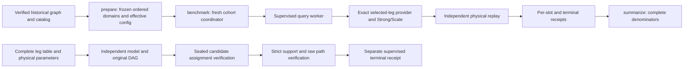

# Research pipeline interfaces

The approved scope is N64 Strong/Scale plus public exact-core and independent
validation interfaces. The main graph is:



## Main input contract

The archive holder supplies an external manifest with this shape:

```json
{
  "schema": "hiroute.artifact_manifest.v1",
  "files": [
    {"role": "graph", "path": "data/real-scale-road.tsv", "bytes": 123, "sha256": "<64 lowercase hexadecimal characters>"},
    {"role": "catalog", "path": "catalog/shared-sites.json", "bytes": 123, "sha256": "<archive SHA256>"},
    {"role": "bindings", "path": "catalog/site-bindings.json", "bytes": 123, "sha256": "<archive SHA256>"}
  ]
}
```

The numbers and placeholders above illustrate the format; they are not a usable
historical manifest. Obtain actual sizes and hashes from the independently held
archive record. Roles and relative paths must be unique. Absolute paths and
paths escaping the explicit archive root are rejected. Every listed artifact is
checked, including additional uniquely named candidate, table, DAG, witness and
receipt roles. Missing inputs are reported together. There is no implicit
download, alternative-map selection or search through old result directories.

For `configs/research/n64.json`, graph/catalog/bindings must additionally match
the frozen identities recorded in the configuration and matrix. The graph TSV
has five tab-separated fields per directed edge: source node, target node,
literal edge ID, exact travel-time rational and exact length rational. It has no
header. Catalog and bindings retain the historical `site_id`, capabilities and
`site_access_nodes` schema. Literal aliases remain distinct from physical nodes.

`prepare` explicitly adapts `real_scale_dev.json` and the frozen matrix. It
checks the physical model, endpoint identity, qualified counts, availability,
candidate order and candidate digest. It writes both energy configurations,
both candidate preflights, `input-verification.json`, `prepared.json` and its
preparation receipt. Subsequent execution checks these saved identities again.
The original v1 `SolverConfig` parser is unchanged and rejects research fields.

Historical processing is an accepted starting point. New-data APIs remain in
`hiroute.data.producer`, `hiroute.data.shandong` and
`hiroute.data.charging_coverage`. Creating inputs from another PBF constitutes a
new research dataset; it cannot fill the original raw-PBF gap.

## Execution and accounting

The N64 protocol retains WD01–WD12, E18/E48, energy-only/schedule, Strong then
Scale: 48 ordered query cells, 96 method slots. Candidate selection is independent
of solver outcomes. DEV remains DEV; neither command creates holdout work.

Each loaded query has 120 s, plus a 180 s cold allowance. The supervisor bounds
the worker's wall/CPU and 8 GiB process-group memory. The underlying runtime
documents sampled RSS/CPU guards and process cleanup; sampling is not an
aggregate kernel hard memory cap. Query-extra and host-headroom policies remain
in the effective pilot configuration. Numeric workers and threads stay at one.

The new run budget defaults to 12,000 CPU s, including a 300 s development/report
precharge. Each fresh pair reserves 1,240 CPU s before launch (310 worker + 310
controller per method). Actual worker CPU, controller CPU and conservative
serialization margins are recorded. Uncertain worker failures retain a reserved
charge and stop further admission. Input validation before the run is reported
separately. No earlier 5,226.078454329 s ledger is carried into a new experiment.

New runs do not automatically reuse historical rows. Historical reporting keeps
the original reuse labels and zero new-stage charges through its compatibility
adapter. This separates observation reuse from a new repetition without changing
the scientific method or dropping either from denominators.

The run directory contains `started.json`, a copy of the prepared contract,
attempt directories with starts/supervisor outcomes/checkpoints, final `rows/`,
`results.json` and `terminal.json`. Outputs must be new. An interrupted directory
without a terminal is evidence to inspect, not permission to restart. There is
no automatic resume or retry of uncertain work. The original directory is never
overwritten or promoted. A later run uses a separately prepared new directory.

`summarize` verifies the aggregate against per-slot receipts and terminal hashes.
Complete/budget-stopped cohorts require all 96 rows. Failed cohorts retain the
full denominator through explicit unattempted slots. Mathematical completion,
resource UNKNOWN, input unavailability and reused observations remain distinct.
Median/p95 intervals retain 120 s censoring; completed-only summaries are labeled
descriptive. Full `K=(J,Q,H,Pi)`, attainment/infimum and physical replay identities
are compared exactly. There is no float tolerance for these quantities.

## Independent candidate bundle

Install `comparison/` independently; it does not depend on `hiroute` or REF.
The bundle is external JSON with exactly these fields:

| Field | Meaning |
| --- | --- |
| `schema` | `hiroute.compare_bundle.v1` |
| `files` | Every required file's relative `path`, integer `bytes`, SHA256; unique paths |
| `table` | `{"format":"json","path":"table.json"}` or `{"format":"split","path":"split-table"}` |
| `parameters` / `incumbent` | Relative paths to physical parameters and the original attained upper witness |
| `graph_db` | Verified immutable raw-edge SQLite input; `edges(eid,u,v,t,l)` |
| `origin` | Directory containing the sealed original consumer evidence |
| `depth` | Original DAG depth, no smaller than the complete table-derived depth |
| `expected` | Original source, producer files, admission/candidate/DAG file hashes and DAG payload hash |

`expected` has exactly `original_source`, `producer_files`, `admission_sha256`,
`candidate_sha256`, `audit_sha256`, `audit_payload_sha256`. The new verifier
records its own identity rather than requiring the historical verifier source.
All identities of original data and receipts remain checked.

The origin must contain `consumer-admission.json`,
`audit-root/SMT/0001.dag.smt2` and
`audit-root/SMT/candidate.unverified.json`. All must be listed in `files`.
Split tables require manifest, numeric JSON, path index and binary path frames;
every frame and pair is validated by the existing bounded reader. JSON tables
retain their byte-level identity. No conversion is silently performed.

The verifier independently reconstructs the mathematical model, matches the
original exported DAG after checked symbol renaming, rejects incomplete or
ill-typed assignments, evaluates exact assertions, obtains strict support and
replays the witness against physical parameters and raw edges. It calls no
solver, optimizer, tactic or SMT parser. Its formulas are not merged with the
production optimizer. Table acceptance does not certify global raw-road path
optimality.

`hiroute-compare verify` defaults to 120 s wall/CPU, 8 GiB address space/RSS and
2 GiB host headroom. All are explicit command options. The parent cleans the
process group and publishes COMPLETE only after successful child termination
and matching body/witness receipts within limits. Resource or validation failure
publishes UNKNOWN. A witness file alone is not terminal acceptance. Original
UNKNOWN records remain unchanged, and no optimality claim is added.

## Compatibility and historical scope

Old data/pilot/comparator module names in `tools/` forward to installed packages
for one transition cycle. Install the corresponding package before invoking
them. Optional policy/cost-diagnostic adapters require the historical tools
checkout and explicit old configuration; they are absent from the N64 profile.
`tools/report_n64_coverage_stage.py` retains historical accounting while delegating
statistical reduction to the pure evaluation module.

Old workflows are manual historical investigations. To reproduce an old source
layout or historical runner, use snapshot `679239d` in a separate checkout with
its recorded dependencies and external artifact archive. Default CI and the
production wheel do not import the old M5D packages. Unresolved producers and
public APIs remain in place until their retained callers and input closure can
be established.
